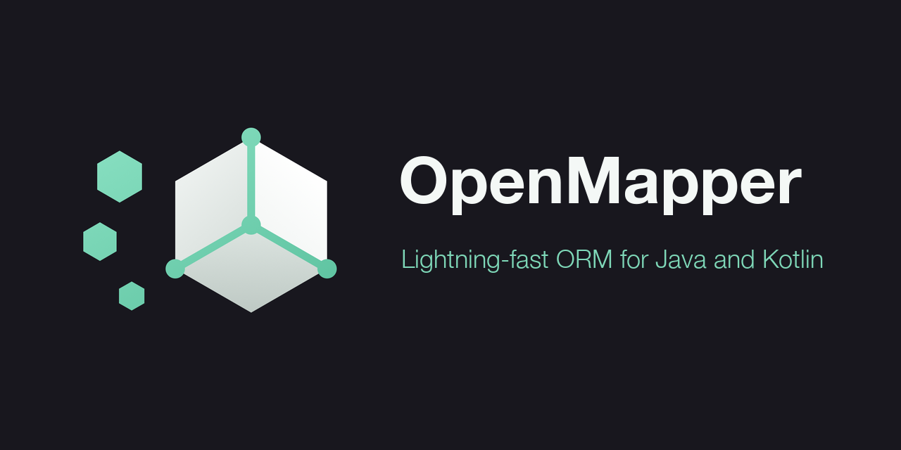

<p align="center">
  
</p>

<p align="center">
  <a href="https://central.sonatype.com/artifact/io.github.serfom256/openmapper-spring-boot-starter"></a>
  <a href="LICENSE"></a>
  
  
</p>

**OpenMapper** is an ORM for JDBC with no persistence context. Statements are declared
in `.fsql` files, entities are mapped by annotation, and repositories are plain interfaces
bound at startup - no query DSL, no generated SQL

Result sets are materialised into object graphs, joined associations included, with no
transitive dependencies

## Contents

- [Sql procedures declaration](#sql-procedures-declaration)
- [Code declaration](#code-declaration)
- [Object mapping example](#object-mapping-example)
- [Object relating mapping](#object-relating-mapping)
  - [Many To Many](#many-to-many)
  - [Many To One](#many-to-one)
  - [One To One](#one-to-one)
  - [Optimistic lock support](#optimistic-lock-support)
  - [Retrieving generated keys after insert](#retrieving-generated-keys-after-insert)
  - [Using @Dto annotation](#using-dto-annotation)
  - [Using @Sql annotation](#using-sql-annotation)
  - [Supported types](#supported-types)
- [Compatibility](#compatibility)
- [Supported annotations](#supported-annotations)
- [Column types](#column-types)
- [JSON columns](#json-columns)
- [Read-only fields](#read-only-fields)
- [Enums](#enums)
- [Inheritance](#inheritance)
- [Generated keys](#generated-keys)
- [Write hooks](#write-hooks)
- [Batch writes](#batch-writes)
- [IN clauses](#in-clauses)
- [Inline statements](#inline-statements)
- [Streaming](#streaming)
- [Pagination](#pagination)
- [Cascade writes](#cascade-writes)
- [Many to many](#many-to-many-1)
- [Upserts](#upserts)
- [Transactions](#transactions)
- [Kotlin](#kotlin)
- [Errors](#errors)
- [OpenMapper configuration](#openmapper-configuration)
- [How to install](#how-to-install)

---

## Sql procedures declaration:

OpenMapper supports files [.fsql] extension

`.fsql` file structure:

```sql
name.of.query={
    select count(*) from users where id=[QUERY_PARAMETER]
}
```
Where:
- name.of.query - name of sql procedure
- select count(*) from users... - SQL query
- [QUERY_PARAMETER] - value to replace when procedure will be executed

## Code declaration:

Repository declaration:

```java

@DaoLayer
public interface MyRepo {

    @DaoMethod(procedure = "name.of.query.from.fsql.file") // this name must be equal with procedure name in .fsql file
    int getUsersCount();
}
```

---

Model declaration:

```java

@Model(primaryKey = "id")
public class User {

    @Field(name = "id")
    private int id;

    @Field(name = "name")
    private String name;

    @Joined(joinBy = "id", to = "userId")
    private List<Course> courses;

    // Getters and setters
}

@Model(primaryKey = "id")
public class Course {

    @Field(name = "course_id")
    private int id;

    @Field(name = "user_id")
    private int userId;

    @Field(name = "data")
    private String data;

    // Getters and setters
}
```

## Object mapping example:

#### Sql procedure:

```sql
select.all.users={
    select * from user join course crs on user.id = crs.user_id where user.id>[id]
}
```

#### Repository:

```java

@DaoLayer
public interface MyRepo {

    @DaoMethod(procedure = "select.all.users")
    List<User> getAll(@Param(name = "id") Integer id);
}
```

Custom objects that used in sql query must be annotated with `@Model` annotation

#### @Model annotation:

primaryKey: primary key of the table

#### @Field annotation:

name: name in sql procedure declared in: `.fsql` file

#### @Param annotation:

name: name in sql procedure that will be replaced with

---

## Object relating mapping:

OpenMapper supports different types of entity objects relationship:

- [x] Many-To-Many
- [x] Many-To-One
- [x] One-To-One

Modeling object relations in code:

### Many To Many:

```java

@Model(primaryKey = "id")
class User {

    @Field
    private Integer id;

    @Field
    private Integer userId;

    @Field
    private String data;

    @Joined(joinBy = "id", to = "userId")
    List<Course> courses;

    // Getters and setters
}

@Model(primaryKey = "id")
class Course {

    @Field
    private Integer id;

    @Field
    private Integer userId;

    @Field
    private String type;

    @Joined(joinBy = "userId", to = "id")
    List<User> users;

    // Getters and setters
}
```

### Many To One:

```java

@Model(primaryKey = "id")
class User {

    @Field
    private int id;

    @Field
    private String name;

    @Joined(joinBy = "id", to = "userId")
    private List<Course> courses;

    // Getters and setters
}

@Model(primaryKey = "id")
class Course {

    @Field
    private Integer id;

    @Field
    private Integer userId;

    @Field
    private String data;

    // Getters and setters
}

```

### One To One:

```java

@Model(primaryKey = "id")
class User {

    @Field
    private int id;

    @Field
    private String name;

    @Joined(joinBy = "id", to = "userId")
    private Course courses;

    // Getters and setters
}

@Model(primaryKey = "id")
class Course {

    @Field
    private Integer id;

    @Field
    private Integer userId;

    @Field
    private String data;

    // Getters and setters
}
```
---

### Optimistic lock support:


#### Model example:
```java
@Model(primaryKey = "id")
public class User {

    @Field
    private int id;

    @Field
    private String name;

    @OptimisticLockField(oldVersion = "oldVersion") // oldVersion - link to previous version to update
    private long version;

    // Getters and setters
}
```

#### Queries in `.fsql` file:

```sql
updateUser = {
    update user set name=[name], version=[version] where version = [oldVersion]  and id = [id]
}

createUser = {
    insert into user(id, name, version) values([id], [name], [version])
}

findUserById = {
    select * from user where id=[id]
}
```
#### Repository example:
```java
@DaoLayer
public interface Repository {
    @DaoMethod(returnKeys = true, operation = DmlOperation.INSERT)
    int createUser(User user);

    @DaoMethod(operation = DmlOperation.UPDATE) // optimistic lock works only with DmlOperation.UPDATE mode
    int updateUser(User user);

    User findUserById(int id);
}
```

#### Service call example:

```java
User user = new User(1, "old_name", 1);
repository.createUser(user); // creating new user with id, name, and default version (if version not specified value will be set to 0)

repository.updateUser(new User(1, "new_name", user.getVersion())); // updating name and version (user version that equals 1 will be updated to 2)

System.out.println(repository.findUserById(1)); // will return User(id=1, name=new_name, version=2)
```

### If the row was changed by someone else, the update matches no row and `OptimisticLockException` is thrown

The call is not retried. Retrying would just write over the other change, so re-read the row,
re-apply your change and call again if that is what you want

Upserts (`DmlOperation.MERGE`) check the version the same way

####  This code produces queries below:
```sql
insert into user(id, name, version) values(1, 'old_name', 1);

update user set name='new_name', version=2 where version = 1 and id = 1;

select * from user where id = 1;
```

---
### Retrieving generated keys after insert:

#### If you specify `returnKeys = true`(by default false) in repository method, then OpenMapper will try to return generated keys and cast them to return type

#### Model example:
```java
@Model(primaryKey = "id")
public class User {

    @Field
    private int id;

    @Field
    private String name;

    // Getters and setters
}
```

#### Queries in `.fsql` file:

```sql
createUser = {
    insert into user(name, version) values([name])
}
```
#### Repository example:
```java
@DaoLayer
public interface Repository {
    @DaoMethod(returnKeys = true, operation = DmlOperation.INSERT)
    int createUser(User user);
}
```

#### Service call example:
```java
User user = new User("name", 1);
int userId = repository.createUser(user);
System.out.println(userId); // will print 1
```

---
### Using @Dto annotation:

#### Dto declaration example:
```java
@Dto
public class DtoUser {

    @Field
    private int id;

    @Field
    private String name;
    
    // Getters and setters
}
```

#### Repository example:
```java
@DaoLayer
public interface Repository {
    @DaoMethod(returnKeys = true, operation = DmlOperation.INSERT)
    int createUser(DtoUser user);
}
```

#### Service call example:
```java
DtoUser user = new DtoUser();
user.setName("user1");
int userId = repository.createUser(user);
```
The main difference between `@Dto` and `@Model` is that @Dto doesn't require primary key specifying, and it cannot be mapped as a query result

---
### Using @Sql annotation:

#### Repository example:
```java
@DaoLayer
public interface Repository {
    @DaoMethod(operation = DmlOperation.SELECT)
    User findUserBy(@Sql query, int id);
}
```

#### Service call example:
```java
int id = 1;
boolean usePagination = true;
boolean useSorting = true;

String query = "SELECT * FROM user WHERE id = [id]";

if (userPagination) {
    query += "OFFSET 10 LIMIT 10";
}
if (useSorting){
    query += "ORDER BY id DESC";
}

User user = repository.findUserBy(query, id);
```

---


### Supported types:

What a `@Field` can map:

| Column types |
| ------------ |
| all primitives and their wrappers |
| String |
| BigDecimal / BigInteger |
| byte[] |
| java.sql Date / Time / Timestamp / Blob |
| java.time LocalDate / LocalDateTime / LocalTime / Instant / OffsetDateTime / OffsetTime |
| UUID |
| any enum, by name or by ordinal |

Anything else needs a `ColumnTypeConverter` bean - see [Column types](#column-types)

What a `@DaoMethod` can return:

| Return types |
| ------------ |
| any `@Model` type |
| all primitives and their wrappers, `String`, `Number` |
| `void` / `Void` |
| `Iterable`, `Collection`, `List`, `ArrayList`, `LinkedList`, `AbstractList` |
| `Stream<E>` - see [Streaming](#streaming) |
| `Page<E>` - see [Pagination](#pagination) |

A return type outside this list fails at startup with `UnsupportedTypeException`

---

## Compatibility

| openMapper | Spring Boot | Java |
| ---------- | ----------- | ---- |
| 2.x        | 3.x, 4.x    | 17+  |
| 1.x        | 2.x         | 17+  |

One artifact runs on both Spring Boot 3 and 4. Every Spring artifact is `provided`, so
your application's version is always the one used and nothing is pinned for you - which
matters in a build that enforces dependency convergence

openMapper brings no dependencies of its own. `spring-jdbc` has to be on your classpath: `spring-boot-starter-jdbc`, `-data-jpa` or
`spring-orm` all bring it

Spring Boot 2 is supported only by the 1.x line, which is no longer developed

#### Outside Spring Boot:

Auto-configuration only fires in a Boot application. In a plain Spring context, import
the configuration yourself

```xml

<bean class="io.github.serfom256.config.OpenMapperConfig"/>
```
Settings are read from the `Environment`, and DAO beans are registered by a
`BeanDefinitionRegistryPostProcessor`, so anything that puts those properties in place
has to be a `BeanDefinitionRegistryPostProcessor` too, ordered ahead of it

#### Usage with Maven:
```xml

<dependency>
    <groupId>io.github.serfom256</groupId>
    <artifactId>openmapper-spring-boot-starter</artifactId>
    <version>2.0.1</version>
</dependency>
```

#### Usage with Gradle:
```groovy
implementation 'io.github.serfom256:openmapper-spring-boot-starter:2.0.1'
```

---

## Supported annotations

| Supported annotations | Type                     | Description                                                                                            |
| --------------------- | ------------------------ | ------------------------------------------------------------------------------------------------------ |
| @Model                | Class level              | Every declared entity that used in mapping uses the @Model annotation                                  |
| @Field                | Field level              | Used for mapping fields specifying, `readOnly = true` maps it on read only                             |
| @Joined               | Field level              | Used for joining entities by the specified field, `saveProcedure` enables cascade writes               |
| @Inheritance          | Class level              | Names the discriminator column that picks the concrete type of a row                                   |
| @Subtype              | Class level              | One discriminator value and the type it maps to, repeatable                                            |
| @OptimisticLockField  | Field/Argument level     | Version field, checked and incremented on update                                                       |
| @Nested               | Field level              | Used for nested objects                                                                                |
| @Json                 | Field level              | Stores the field as JSON in a text column, read back into its type                                     |
| @DaoLayer             | Class level              | DAO/Repository classes that represents data access layer should be annotated with @DaoLayer annotation |
| @DaoMethod            | Method level             | Used for method that executes the query and returns mapped result                                      |
| @Param                | Argument parameter level | Used for specifying name of the argument that will be substituted in the sql query                     |
| @UseRepository        | Class level              | Used for service layer classes that will be interacting with DAO layer                                 |
| Procedures            | Bean                     | Runs a statement written in place, no .fsql file or interface needed                                   |
| @Cached               | Method level             | Used for query cache for this method, ignores configuration `openmapper.query.cache.enabled`           |
| IdGenerator           | Bean                     | Supplies a primary key the database does not generate, assigned just before insert                     |
| EntityWriteListener   | Bean                     | Called with an entity just before it is written                                                        |
| @Sql                  | Argument level level     | Used for specifying custom query as a string                                                           |
| @Dto                  | Class level              | Used for specifying abstract data type as query parameters                                             |

---

## Column types:

Supported out of the box: all primitives and their wrappers, `String`, `BigDecimal`,
`BigInteger`, `byte[]`, `java.sql` date types, `java.time` (`LocalDate`, `LocalDateTime`,
`LocalTime`, `Instant`, `OffsetDateTime`, `OffsetTime`), `UUID`, and any `enum` (by name)

For anything else declare a converter as a bean

```java

@Component
public class MoneyConverter implements ColumnTypeConverter<Money> {

    public Class<Money> type() {
        return Money.class;
    }

    public Money fromColumn(ResultSet rs, String column) throws SQLException {
        BigDecimal amount = rs.getBigDecimal(column);
        return amount == null ? null : new Money(amount);
    }

    public Object toParameter(Money value) {
        return value == null ? null : value.amount();
    }
}
```
Converters win over the built-in types, so you can also override one

---

## JSON columns:

A field marked `@Json` is written as JSON text and read back into its own type

```java

@Field(name = "attributes")
@Json
private Map<String, String> attributes;
```
Needs Jackson on the classpath - either `com.fasterxml.jackson.core:jackson-databind`
(Jackson 2) or `tools.jackson.core:jackson-databind` (Jackson 3), both optional
dependencies - or your own `Serializer` bean. Without one, a `@Json` field fails at
startup rather than at the first query

Jackson 3 is preferred when both are present, and it needs `jackson-annotations` 2.19 or
newer. Spring Boot pins that version, and only 3.5+ pins one recent enough - on Boot 3.0
to 3.4 either use Jackson 2 or override `jackson-annotations` yourself

---

## Read-only fields:

Values the database produces - a computed column, a `DEFAULT`, a trigger - are mapped on
read and left out of writes

```java

@Field(name = "book_count", readOnly = true)
private int bookCount;
```
The same model can be inserted without the insert referring to a column it cannot set

---

## Enums:

Stored by name by default, by position when the column is numeric

```java

@Field(name = "status")
private Status status;

@Field(name = "priority", enumType = EnumType.ORDINAL)
private Priority priority;
```
`ORDINAL` is there for tables that already hold ordinals - reordering the constants
rewrites what existing rows mean

---

## Inheritance:

A subclass inherits its parent's `@Field`s, so only its own columns need declaring

```java

public abstract class Auditable {

    @Field(name = "id")
    private long id;

    @Field(name = "created_by")
    private String createdBy;
}

@Model(primaryKey = "id")
public class Note extends Auditable {

    @Field(name = "body")
    private String body;
}
```

To pick the concrete type per row, name a discriminator column and list the subtypes

```java

@Model(primaryKey = "id")
@Inheritance(discriminator = "item_type")
@Subtype(value = "BUNDLE", type = BundleItem.class)
@Subtype(value = "SKU", type = SkuItem.class)
public class CatalogItem { ... }
```

```java

@DaoMethod(operation = DmlOperation.SELECT)
List<CatalogItem> findItems();
```

Because you write the SQL, one table with a discriminator column and a base table outer
joined to per-subtype tables are the same feature - the query decides

```sql
findItems = {
    SELECT i.id, i.item_type, i.name, b.bundle_size, s.sku_code
    FROM item i
    LEFT JOIN bundle b ON b.item_id = i.id
    LEFT JOIN sku s ON s.item_id = i.id
}
```
A `NULL` discriminator maps to the base type. An undeclared value throws, naming the
column and the value. Writes are not polymorphic - the procedure decides where a row goes

---

## Generated keys:

When the database makes the key, read it back

```java

@DaoMethod(operation = DmlOperation.INSERT, returnKeys = true)
long insertProduct(Product product);
```

When the application makes it - a sequence table, a UUID, an allocator shared with an
existing system - declare a generator as a bean

```java

@Component
public class OrderIdGenerator implements IdGenerator<Order> {

    public Class<Order> type() {
        return Order.class;
    }

    public Object generate(Order order) {
        return allocator.next("ORDER");
    }
}
```
It is called just before the insert and assigns the field named by
`@Model(primaryKey = ...)`, on single writes, on every element of a batch and on cascaded
children. It runs only when the key is still unset - `null`, a zero number or an empty
string - so a key you set yourself is kept. `type()` matches subtypes, and the most
specific generator wins

---

## Write hooks:

A bean called with the entity just before it is written

```java

@Component
public class AuditListener implements EntityWriteListener<Auditable> {

    public Class<Auditable> type() {
        return Auditable.class;
    }

    public void beforeWrite(Auditable entity, DmlOperation operation) {
        if (operation == DmlOperation.INSERT) {
            entity.setCreatedAt(Instant.now());
        }
        entity.setUpdatedAt(Instant.now());
    }
}
```
`type()` matches subtypes, so one listener covers a hierarchy. Fires for single writes,
every element of a batch and cascaded children. Reads never fire it

---

## Batch writes:

A write method taking a collection of models runs as one batch

```java

@DaoMethod(procedure = "insertProduct", operation = DmlOperation.INSERT)
int insertProducts(List<Product> products);
```
The same procedure serves both the single and the collection form. Generated keys and
optimistic locking work per element

---

## IN clauses:

A collection parameter expands into one placeholder per element

```sql
findByIds = {
    SELECT id, name FROM product WHERE id IN ([ids])
}
```
```java

@DaoMethod(operation = DmlOperation.SELECT)
List<Product> findByIds(@Param(name = "ids") List<Long> ids);
```

An empty list is not an error: `IN ([])` matches nothing and `NOT IN ([])` excludes
nothing, which is what you would write by hand

Past `openmapper.in.clause.chunk.size` elements (1000 by default, matching Oracle's
limit) the clause is split, so a long list does not hit the database's cap

```sql
WHERE t.id IN (?, ?, ...) OR t.id IN (?, ?, ...)
```
`NOT IN` splits with `AND` instead. Set the property to `0` to switch it off

---

## Inline statements:

When a statement does not deserve a file and an interface, inject `Procedures`

```java

@Service
public class ReportService {

    private final Procedures procedures;

    public List<Product> expensive(BigDecimal from) {
        return procedures.select(
                "SELECT id, name, price FROM product WHERE price > [from] ORDER BY id",
                Product.class, Map.of("from", from));
    }
}
```
Same placeholders, same binding, same mapping - a `@Model` comes back as a full graph with
its `@Joined` associations, anything else as a scalar

```java
Optional<Product> one = procedures.selectOne("SELECT ... WHERE id = [id]", Product.class, Map.of("id", 1L));
long rows = procedures.execute("UPDATE product SET quantity = [quantity] WHERE id = [id]",
        DmlOperation.UPDATE, Map.of("quantity", 5, "id", 1L));
Optional<Long> id = procedures.executeReturningKey("INSERT INTO product ...", DmlOperation.INSERT,
        Long.class, Map.of("name", "widget"));
```
`execute` counts rows with `executeLargeUpdate` where the driver supports it, so a count
past `Integer.MAX_VALUE` survives

Statements join the caller's transaction like any DAO method. Defaults come from a
`ProceduresCustomizer` bean

```java

@Component
public class ReportProceduresCustomizer implements ProceduresCustomizer {

    public void customize(ProceduresBuilder builder) {
        builder
            .fetchSize(500)
            .queryTimeoutSeconds(30)
            .statementCacheSize(256);
    }
}
```
What you give up is startup validation and keeping the SQL in one file, so prefer a
`@DaoLayer` method for anything routine

---

## Streaming:

Return `Stream<E>` to map rows one at a time instead of building a list

```java

@DaoMethod(procedure = "findByName", operation = DmlOperation.SELECT, fetchSize = 500)
Stream<Product> streamByName(@Param(name = "name") String name);
```
```java
try (Stream<Product> products = repository.streamByName("widget")) {
    products.forEach(this::handle);
}
```
The stream holds the result set open, so close it - the connection is returned on close

Entities with `@Joined` stream too, but the query must order by the root id so each entity
is complete before the next begins. OpenMapper throws if it sees a root twice

`fetchSize` only takes effect inside a transaction, the driver needs an open cursor

---

## Pagination:

```sql
findPaged = {
    SELECT id, name FROM product WHERE name = [name] ORDER BY id LIMIT [limit] OFFSET [offset]
}
countByName = {
    SELECT count(*) FROM product WHERE name = [name]
}
```
```java

@DaoMethod(procedure = "findPaged", countProcedure = "countByName")
Page<Product> findPaged(@Param(name = "name") String name, PageRequest pageRequest);
```
```java
Page<Product> page = repository.findPaged("widget", PageRequest.of(0, 20));
page.content();
page.totalElements();
page.hasNext();
```
`limit` and `offset` come from the `PageRequest`, the count runs as a second statement with
the same parameters

---

## Cascade writes:

Give `@Joined` a `saveProcedure` and its elements are written after the parent

```java

@Joined(joinBy = "id", to = "authorId", saveProcedure = "insertBookForAuthor")
private List<Book> books;
```
```sql
insertBookForAuthor = {
    INSERT INTO book (title, author_id) VALUES ([title], [author_id])
}
```
The parent key is bound under the column of the `to` field, so the element does not have to
carry it. Elements go in one batch

Without `saveProcedure` the association stays read-only. Rows that exist in the database but
are missing from the collection are left alone - delete them yourself

---

## Many to many:

Join through the link table in your query and point `to` at the link column

```java

@Joined(joinBy = "id", to = "student_id", saveProcedure = "linkStudentCourse")
private List<Course> courses;
```
```sql
findStudentWithCourses = {
    SELECT s.id, s.name, c.id AS course_id, c.title FROM student s LEFT JOIN student_course sc ON s.id = sc.student_id LEFT JOIN course c ON c.id = sc.course_id WHERE s.id = [id] ORDER BY s.id
}
linkStudentCourse = {
    INSERT INTO student_course (student_id, course_id) VALUES ([student_id], [course_id])
}
```
The cascade writes link rows, not the far-side entities - they must already exist

Do not use a name that matches a field on the far side, it would be read as a foreign key and
filter your rows

---

## Upserts:

```sql
upsertInventory = {
    INSERT INTO inventory (sku, quantity, version) VALUES ([sku], [quantity], [version]) ON CONFLICT (sku) DO UPDATE SET quantity = [quantity], version = [version] WHERE inventory.version = [old_version]
}
```
```java

@DaoMethod(operation = DmlOperation.MERGE)
void upsertInventory(Inventory inventory);
```
A parameter can be used as many times as you need. `MERGE` checks and advances
`@OptimisticLockField` the same way `UPDATE` does

---

## Transactions:

OpenMapper joins Spring transactions. Inside `@Transactional` DAO calls use the same
connection, so they commit and roll back with the rest of the method

```java

@UseRepository
public class OrderService {

    @Transactional
    public void place(Order order) {
        orderDao.insert(order);      // rolled back together
        stockDao.decrement(order);   // if anything fails
    }
}
```

Outside a transaction each call takes a connection from the pool. No configuration needed

Note: a DAO bound to another datasource with `@DaoLayer(dataSource = "...")` joins only
transactions of that datasource

---

## Kotlin:

Models work with `var` properties and a no-arg constructor

```kotlin

@Model(primaryKey = "id")
class Product {
    @field:Field(name = "id")    var id: Long = 0
    @field:Field(name = "name")  var name: String? = null
}
```
Note `@field:` — without it the annotation lands on the constructor parameter, not the field

Repositories are plain interfaces

```kotlin

@DaoLayer
interface ProductDao {

    @DaoMethod(procedure = "findProductById")
    fun findById(@Param(name = "id") id: Long): Product?
}
```

`data class` works too, built through its primary constructor

```kotlin

@Model(primaryKey = "id")
data class Product(
    @field:Field(name = "id")   val id: Long,
    @field:Field(name = "name") val name: String
)
```

Java `record` works the same way

Immutable types have two limits: every field must be mapped, and a column missing from the
query gives the default value instead of being skipped. `@Joined` and `@Nested` need a
mutable type

---

## Errors:

Database failures are thrown as Spring `DataAccessException`, the same types JPA and
`JdbcTemplate` throw

```java
try {
    productDao.insert(product);
} catch (DuplicateKeyException e) {
    // ...
}
```

---

## OpenMapper configuration

| Parameter name                         | Parameter type | Default value                      | Description                                                    |
| -------------------------------------- | -------------- | ---------------------------------- | -------------------------------------------------------------- |
| openmapper.fsql.path                   | list<string>   | all subdirectories in project root | Package to scan for `.fsql` files                              |
| openmapper.dao.packagesToScan          | string         | package of @SpringBootApplication  | Packages to scan for @DaoLayer interfaces, comma-separated      |
| openmapper.model.packagesToScan        | string         | package of @SpringBootApplication  | Packages to scan for @Model and @Dto classes, comma-separated   |
| openmapper.sql.tracing.enabled         | boolean        | false                              | Tracing sql  queries                                           |
| openmapper.sql.tracing.queries.enabled | boolean        | false                              | Tracing sql that will be executed (don't use it in production) |
| openmapper.logging.enabled             | boolean        | false                              | Enable internal logging                                        |
| openmapper.query.cache.enabled         | boolean        | false                              | Enable global query cache                                      |
| openmapper.in.clause.chunk.size        | int            | 1000                               | Split a longer IN list into several clauses, `0` disables it   |

Per-method settings live on `@DaoMethod`: `fetchSize`, `queryTimeoutSeconds`, `countProcedure`,
`returnKeys`, `translateNotFoundExceptionTo`

---

## How to install

Available on Maven Central as `io.github.serfom256:openmapper-spring-boot-starter`, see
[Compatibility](#compatibility) for the dependency snippet

To build from source

- `git clone git@github.com:serfom256/OpenMapper.git && cd OpenMapper && mvn install`